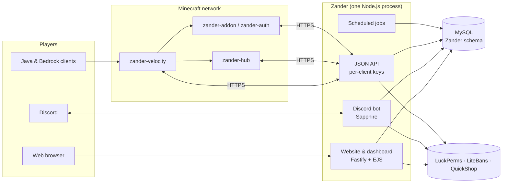

<div align="center">

# Zander

**One platform for your whole Minecraft community: website, staff dashboard, Discord bot and server plugins, all on one account system and one database.**

[](CHANGELOG.md)
[](https://anchorlight.dev/docs/products/zander/installation)
[](https://anchorlight.dev/docs/products/zander/features/minecraft-plugins)
[](agent/)
[](commands/)

[Features](#features) · [How it fits together](#how-it-fits-together) · [Quick start](#quick-start) · [Documentation](#documentation) · [Changelog](CHANGELOG.md)

</div>

---

Running a Minecraft network usually means stitching together a website, a forum, a ticket bot, a donation store, a ban list and a dozen plugins that don't know about each other. **Zander replaces that patchwork.** A player links their Minecraft and Discord accounts once, and from then on the website, the Discord server and every game server agree on who they are, what rank they hold and what they're allowed to do.

Staff run everything from the browser. Settings, modules, menus, pages, events, holograms and permissions are all edited in the dashboard and take effect without touching a config file or restarting a server.

Zander powers the **[Crafting For Christ](https://craftingforchrist.net)** Minecraft network.

## Why Zander

- **One identity everywhere.** Minecraft, Discord and website accounts are linked, and ranks come straight from LuckPerms, so a promotion in-game is a promotion on the site and in Discord.
- **Run it from the browser.** Site settings, feature modules, navigation menus, custom pages and API keys all live in the dashboard. Turn a whole module on or off with one switch.
- **Built for real staff teams.** Fine-grained permissions (each tick box is a LuckPerms node), review workflows for events and resources, and an audit trail of who changed what.
- **Secure by default.** Per-server API keys with scoped access, CSRF and cross-site protection, rate limiting, sanitised rich text and a hardened session setup. See the [security notes](CHANGELOG.md#security).
- **Modular.** Every major feature is a self-contained module you can switch off, so a small server can start lean and grow into the rest.

## Features

### Community website

| | |
|---|---|
| **Events** | A public calendar with event pages, rank-locked events with teaser descriptions, and automatic announcements to Discord, MOTD, in-game tips and the site. |
| **Forums** | Categories with access rules, discussions, replies, polls and revision history, with the latest posts shown on the homepage. |
| **Player profiles** | Linked accounts, badges, birthdays, time zones and social links. |
| **Custom pages and menus** | Publish your own pages and edit the top bar, header and footer menus without a deploy. |
| **Resources** | A curated resource library where members suggest links and staff vote on them. |
| **Shop directory** | Search every player shop on the server, including enchantments, potions and shulker contents. Also available as `/shopdirectory` in Discord. |
| **Webstore and donations** | A Stripe-powered store with subscriptions and in-game delivery of purchases, plus a donation page with a monthly server-cost goal. |
| **Finance transparency** | An optional public report showing where community money goes. |
| **Watch** | Live Twitch and YouTube streams from your creators, with in-game "now live" announcements. |
| **Support** | Tickets from the website, Discord or a contact form. Guests without an account can follow their ticket through a private emailed link. |
| **Applications and forms** | Staff applications and surveys with eligibility rules, drafts, cooldowns and review. Submissions can open a ticket or a Discord thread. |
| **Bedrock and play pages** | Connection details for Java and Bedrock players. |
| **Punishments and appeals** | A public punishment list from LiteBans and an appeal form. |

### Staff dashboard

- **Settings and modules:** every site setting and feature switch, editable live.
- **Users and ranks:** user administration with masked emails, and rank permissions granted from a checklist of documented nodes.
- **Events:** draft → review → publish, templates, and default announcements applied across events.
- **Holograms:** design in-game holograms with countdowns and expiry dates, then place them with `/hologram create`.
- **Scheduler and announcements:** scheduled Discord embeds, site banners and announcements.
- **Webstore and finance:** products, categories, purchases, budgets, transactions and reports.
- **API keys:** a separate key for each server and service, each limited to the API areas it needs.
- **Logs:** audit trails for staff actions.

### Discord bot

Slash commands for players and staff: `/apply`, `/ticket`, `/report` (plus right-click **Report Message**), `/profile`, `/ranks`, `/shopdirectory`, `/poll`, `/watch`, `/vault`, `/resources`, `/play`, `/rules`, `/website`, `/punish`, `/audit`, `/lpaudit`, `/forcelink`, `/staffhelp` and more.

It also handles the background work:

- **Rank role sync:** Discord roles follow LuckPerms ranks.
- **Booster rewards:** server boosters get a rank, which is removed when the boost ends.
- **Verification reminders** for members who haven't linked their account.
- **Nickname enforcement** and **birthday ranks**.
- **Content filtering** of links and phrases through MineMonitor.
- **Discord punishments** synced with the moderation system.
- **Staff audit reports** and activity tracking.

### Minecraft plugins

| Plugin | Runs on | What it does |
|---|---|---|
| **zander-velocity** | Velocity proxy | Account linking and verification, private messages with ignore and toggle, reports, network chat moderation (`/alert`, `/clearchat`, `/freezechat`), session tracking and rotating tips. |
| **zander-hub** | Hub server | Portals and server navigation, a navigation compass, hub protection, `/connect` and `/fly`. |
| **zander-addon** | Each game server | Dashboard holograms, `/policy`, `/social`, `/freeze`, and delivery of webstore purchases. |
| **zander-auth** | Each game server | Checks each joining player against their website account. |

### Integrations

LuckPerms · LiteBans · QuickShop-Hikari · Geyser/Floodgate (Bedrock) · Stripe · Twitch · YouTube · MineMonitor / Purify · Cloudinary · Web Push · Sentry · OpenID Connect (Zander can sign staff in to other tools, such as the Compass staff portal)

## How it fits together



The website, dashboard, API and Discord bot run in a **single Node.js process** and share the same controllers, so a slash command and a web page call exactly the same code. Game servers talk to Zander over HTTPS with their own scoped API key, and Zander reads ranks, punishments and shops directly from the LuckPerms, LiteBans and QuickShop databases.

## Quick start

**You'll need** Node.js 20 or newer (22 recommended), MySQL, a Discord bot token, and for the plugins Java 21 with Maven.

```bash
git clone https://github.com/AnchorlightDev/zander.git
cd zander
cp .env.example .env      # fill in DATABASE_URL, sessionCookieSecret, Discord keys…
npm run build             # installs, runs every migration, generates the client
npm run dev               # http://localhost:3000
```

Build the Minecraft plugins:

```bash
cd agent
mvn                       # jars land in agent/target/plugins/
```

Then sign in, open **Dashboard → API Keys** to issue a key for each server, and switch on the modules you want under **Dashboard → Modules**. The full walkthrough is in the **[installation guide](https://anchorlight.dev/docs/products/zander/installation)**.

## Documentation

Full documentation is at **[anchorlight.dev/docs/products/zander](https://anchorlight.dev/docs/products/zander)**.

| Guide | |
|---|---|
| [Installation](https://anchorlight.dev/docs/products/zander/installation) | Prerequisites, `.env`, database and first run |
| [Upgrading to 2.2.0](https://anchorlight.dev/docs/products/zander/upgrading) | What changed and the steps to upgrade |
| [Configuration](https://anchorlight.dev/docs/products/zander/configuration) | Environment variables, site settings and modules |
| [Permissions](https://anchorlight.dev/docs/products/zander/permissions) | Every `zander.*` LuckPerms node, web and in-game |
| [API authentication](https://anchorlight.dev/docs/products/zander/api/authentication) | Per-server API keys, scopes and revocation |
| [Features](https://anchorlight.dev/docs/products/zander/features/) | Every module, from events and forums to holograms and the webstore |
| [Minecraft plugins](https://anchorlight.dev/docs/products/zander/features/minecraft-plugins) | What each plugin does, and how to configure it |
| [Administration](https://anchorlight.dev/docs/products/zander/admin/setup) | Deployment, database and troubleshooting |
| [Changelog](CHANGELOG.md) | What changed in each release |

## Built with

Node.js · Fastify · EJS · Prisma (migrations) · MySQL · Discord.js / Sapphire · Stripe · Vitest, and Java 21 · Paper · Velocity · Maven for the plugins.

## Contributing

1. Branch from `staging`; `master` is the released code.
2. Run `npm test` before opening a pull request.
3. Database changes go in a new numbered folder under `prisma/migrations/`.
4. New dashboard permission nodes go in `lib/permissions/zanderNodes.mjs`. Run `node scripts/permissionsTable.mjs` and paste the output into the [permissions page](https://anchorlight.dev/docs/products/zander/permissions) on the docs site.
5. Add a line to the `CHANGELOG.md` section for the next release.

## License

ISC, as declared in [`package.json`](package.json).
